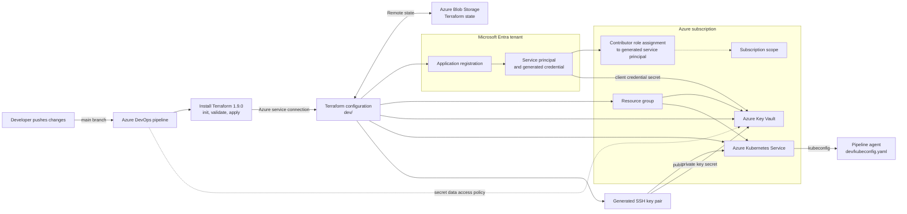

# Terraform Azure Infrastructure

Terraform configuration for provisioning an Azure development environment with an Azure resource group, an Entra ID application and service principal, an Azure Key Vault, and an Azure Kubernetes Service (AKS) cluster.

For known deployment failures and their step-by-step resolutions, see the [KEDB runbook](./KEDB-RUNBOOK.md).

## What gets deployed

The root configuration in `dev/` provisions:

- An Azure resource group.
- An Entra ID application, service principal, and client secret.
- A subscription-scoped `Contributor` role assignment for the generated service principal.
- An Azure Key Vault and secrets for the service principal credentials and AKS SSH private key.
- An AKS cluster with a generated SSH key.
- A kubeconfig file at `dev/kubeconfig.yaml`.

Terraform state and outputs can contain credentials and private key material. Protect access to the remote state, pipeline logs, generated kubeconfig, and any saved plan files. Never commit secrets or publish them in logs.

## Architecture



The pipeline identity authenticates Terraform through the Azure service connection. It is distinct from the generated service principal, which receives the subscription role assignment and is configured on AKS. The SSH private key, generated service-principal credential, Terraform state, and kubeconfig are sensitive; secure their storage and pipeline access.

## Prerequisites

- An Azure subscription and Microsoft Entra tenant.
- Azure CLI for local use, authenticated to the intended tenant and subscription.
- Terraform **1.9.0 or later**, as required by `dev/providers.tf`.
- An Azure DevOps project and an Azure Resource Manager service connection for pipeline deployments.
- Administrative approval for the required Entra directory and Azure RBAC permissions (details below).
- A globally unique Azure Key Vault name.

The provider versions are declared in `dev/providers.tf` and locked in `dev/.terraform.lock.hcl`.

## Configure

Set deployment-specific, non-secret values in `dev/terraform.tfvars`:

| Variable | Purpose |
| --- | --- |
| `rg_name` | Azure resource group name |
| `location` | Azure region for the resource group, Key Vault, and AKS |
| `service_principal_name` | Display name for the Entra application |
| `key_vault_name` | Globally unique Key Vault name (3–24 letters, digits, or hyphens) |
| `SUB_ID` | Subscription ID used for the generated service principal's role assignment |
| `aks_cluster_name` | AKS cluster name |

Do not put client secrets, passwords, or private keys in `terraform.tfvars`. Supply credentials through the approved Azure service connection or secure pipeline variables.

The remote state backend is declared in `dev/backend.tf`. The Azure DevOps pipeline also provides backend settings during `init`; keep the backend resource group, storage account, container, and state key consistent across both definitions. Before local operations, confirm the values point at the intended state.

## Local workflow

From the repository root, authenticate to Azure and run:

```sh
az login
az account set --subscription "<subscription-id>"
terraform -chdir=dev init -backend-config="key=dev.terraform.tfstate"
terraform -chdir=dev validate
terraform -chdir=dev plan
```

Review the plan carefully for unexpected replacement or destruction. Apply only after the plan is approved:

```sh
terraform -chdir=dev apply
```

The explicit backend key above matches the key currently configured in the Azure DevOps pipeline. The `key` in `dev/backend.tf` is `dev.tfstate`; using that default locally without overriding it would select a different state blob. Confirm the intended state key with the infrastructure owner before running commands if the backend configuration has changed.

## Azure permissions

The identity used by the deployment must be authorized in both Azure Resource Manager and Microsoft Entra ID:

- **Azure resources:** appropriate permissions to create the resource group, Key Vault, and AKS resources.
- **Entra application creation:** permission to create/manage the applications and service principals, granted by an Entra administrator according to tenant policy.
- **Subscription role assignment:** the configuration creates a subscription-scoped `Contributor` assignment. The pipeline identity needs a role that allows role assignment writes at that scope, such as **Role Based Access Control Administrator** or **User Access Administrator**. `Contributor` alone is insufficient.
- **Key Vault secrets:** the Key Vault module grants the current AzureRM identity `Get`, `Set`, and `Delete` secret permissions using an access policy. The identity applying that policy must already be permitted to manage Key Vault access policies. If the vault uses Azure RBAC instead, configure the appropriate data-plane role and permission model.

Grant permissions to the service principal behind the pipeline's service connection—not to a developer's personal account unless that account is actually used for the deployment. Use the narrowest scope allowed by the deployment design.

## Azure DevOps

`create.yml` runs on pushes to `main`. It installs Terraform, initializes the backend, validates the configuration, and applies it from the `dev/` directory. Update the service connection name and backend settings in the YAML if they differ in your Azure DevOps project. Ensure Terraform installation and initialization run in the same job as the apply because hosted agents are ephemeral.

`destroy.yml` has no automatic trigger, but it contains a Terraform `destroy` step. Run it only through an explicitly approved process after verifying the correct environment and state; it can delete deployed infrastructure and data.

## Troubleshooting

For errors such as Terraform version/installer failures, Entra authorization, RBAC assignment denial, Key Vault access or naming conflicts, AKS availability zones, and OIDC issuer updates, follow the [KEDB runbook](./KEDB-RUNBOOK.md).
